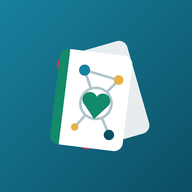
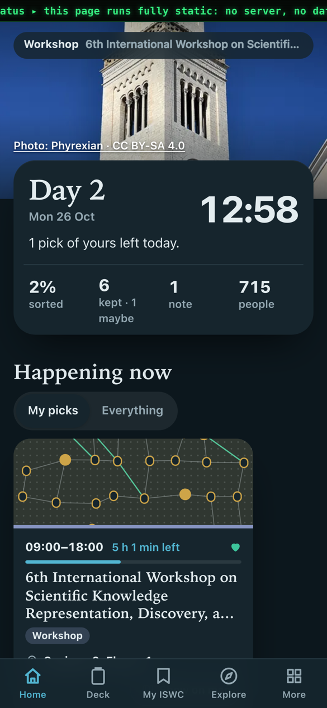
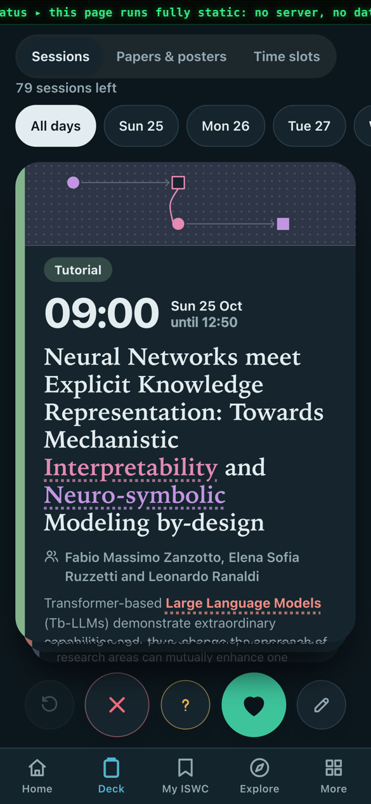
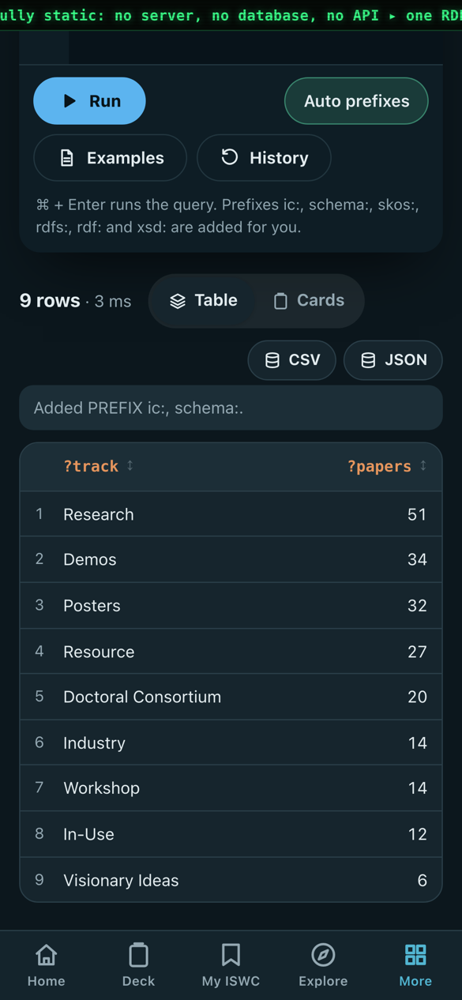
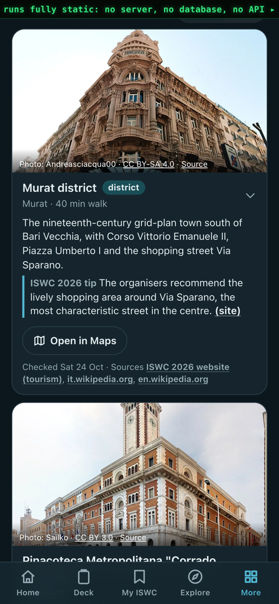
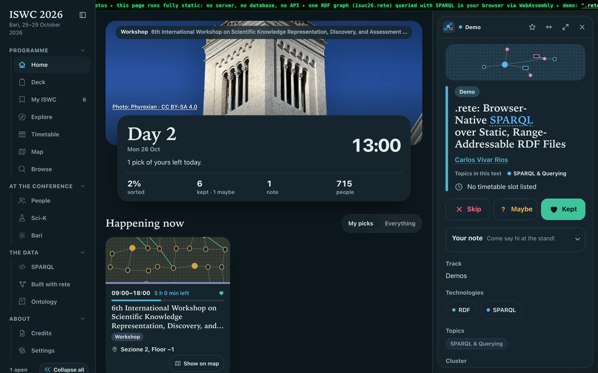
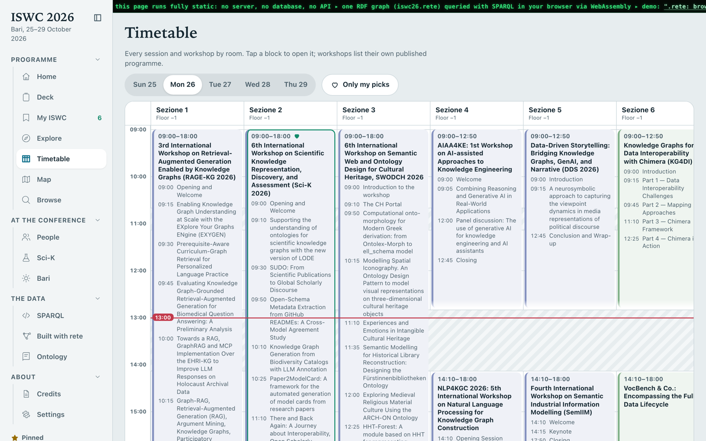
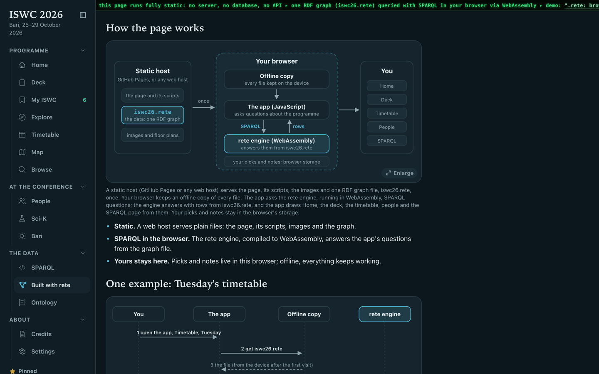

<h1 align="center">ISWC 2026 Companion</h1>

An unofficial companion for the 25th International Semantic Web Conference (Bari, 25–29 October 2026). 
<strong><a href="https://caviri.github.io/iswc-2026-companion/">Open the app</a></strong> · install it from your browser and it works offline.

## What it does

- **Swipe through the programme**: keep, skip or maybe every session, paper, poster and demo; take notes.
- **My ISWC**: your own day-by-day timeline with clash warnings and what's on now and next.
- **Timetable** by room, with the workshops' own timed programmes (Sci-K and more).
- **Explore** the topics and clusters of the programme, **browse** and search everything, find rooms on the floor plans.
- **People**: organisers, chairs, speakers and authors with affiliations, links and short bios.
- **Bari**: concerts tonight, sights, food, comics and day trips, with walking times from the venue.
- **SPARQL explorer**: query the whole programme as a knowledge graph, with ready-made examples.
- **Your data stays yours**: picks and notes live in your browser; download or import them as JSON or `.rete`.

## How it works

The whole app is a static page. There is no server, database or API: the programme is one RDF graph file,
`data/iswc26.rete`, and your browser asks it SPARQL questions with the [rete](https://github.com/caviri/rete) engine
compiled to WebAssembly. The vocabulary is published with the app (`data/iswc26-ontology.ttl`, readable in the app
under Ontology).

rete will be shown at the ISWC 2026 Posters & Demos session: **Tuesday 27 October, 19:15–21:00, Plenary**. Come and
talk to us at the demo, and try the playground at [caviri.github.io/rete](https://caviri.github.io/rete/) and
[demo.graphplaza.com](https://demo.graphplaza.com).

## Made by

[Carlos Vivar Ríos](https://github.com/caviri) ([ORCID 0000-0002-8076-2034](https://orcid.org/0000-0002-8076-2034)),
on data gathered from public places: the ISWC 2026 website and the workshops' own websites, Springer and Crossref,
OpenAlex, DBLP, ORCID, Wikidata, Wikipedia (CC BY-SA), ROR, Wikimedia Commons, OpenStreetMap and GitHub. Every image is
openly licensed and credited on the app's Credits page. Not endorsed by the conference organisers.

## This repository

It holds only the built site, generated from a private source repository (`make public`), which leaves out the
personal travel features and refuses to build if any personal travel detail would end up in the files. Every push
to `main` publishes it with GitHub Pages (`.github/workflows/pages.yml`).

The code is under the MIT licence (`LICENSE`); the data and images keep their own licences, listed in the app.
